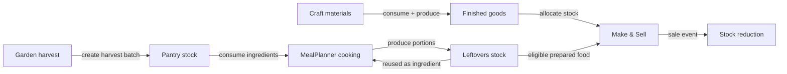

# BoxTrack — Workspaces, Bridges and Integrations

## General rule

Workspaces are **views into the same inventory engine**, not separately owned inventory databases. A location (cabin, RV, locker) is not a workspace unless it needs a distinct workflow. Modules can be enabled/hidden per user or household, while permissions remain server-enforced.

| Workspace | Emphasis | Typical operations |
| --- | --- | --- |
| Storage | Box, shelves, lockers, loose things | Photograph, locate, scan, audit, print |
| Pantry & Food | Lots, quantity, freshness, leftovers | Acquire, cook, consume, give away, spill, spoil |
| Belongings | Durable assets, warranty, lending, resale | Purchase, move, lend, return, list, sell |
| Crafts & Hobbies | Yarn, filament, wood, components | Acquire, consume in project, waste |
| Make & Sell | Products, batches, fair stock | Produce, allocate, sell, return |
| Garden | Seeds, plants, beds, harvest | Plant, care, harvest, give away |
| Camping/RV | Gear, supplies, trip packing | Pack checklist, relocate, maintain |
| Digital | Licences, subscriptions, renewals | Assign seats, renew, cancel |
| Presents | Private ideas through hiding and giving | Plan, order, ship, receive, wrap, gift |

## Typed bridge actions

A bridge rule names input capabilities, allowed outcome, authorization, validation and resulting transaction. It never simply copies a record into another silo.

Transfers between rooms/shelves only change physical location. Allocating goods for sale changes reserved/available quantities but does not fabricate new units. Food spoilage, spills, consumption, and gifts to neighbors reduce stock, generally without tracking the recipient. Keep lot/batch tracing, unit conversion and transaction history. Planned meals do not automatically consume ingredients; actual cooking records consumption.

## MealPlanner integration

MealPlanner owns its recipes, cooking guidance, nutrition and planned meals. The BoxTrack/inventory domain owns stock lots, availability, inventory movements and traceability. MealPlanner queries authorized household inventory; completed cooking writes idempotent consumption and production operations. It can produce leftovers, which are independently consumable or reusable in new meals. Cross-app sharing/permissions follow GroundCore's API and consent conventions; never query the other app's DB directly.

## Square and other POS (proposed)

Introduce a provider-neutral Commerce adapter for product mapping, sellable inventory, paid orders/sales, refunds/cancellations, sync reconciliation and craft fair locations. Square can be a first adapter; do not make it core domain. Ensure POS inventory webhooks/orders cannot double-decrement stock; support offline reconciliation. Payments, taxes and merchant compliance remain within the POS/provider where appropriate.

For food sales, provenance, lot tracking, expiry, labeling and local regulatory review may be necessary; a sellable flag alone must not imply eligibility to sell homemade food.

## Configurable modules

Workspace manifests may declare navigation, filters, supported item capabilities, field groups and action IDs. Server owns action schemas, permission checks, stock invariants and atomic transformations. Reject any attempt to embed arbitrary executable code in user-provided manifests.
