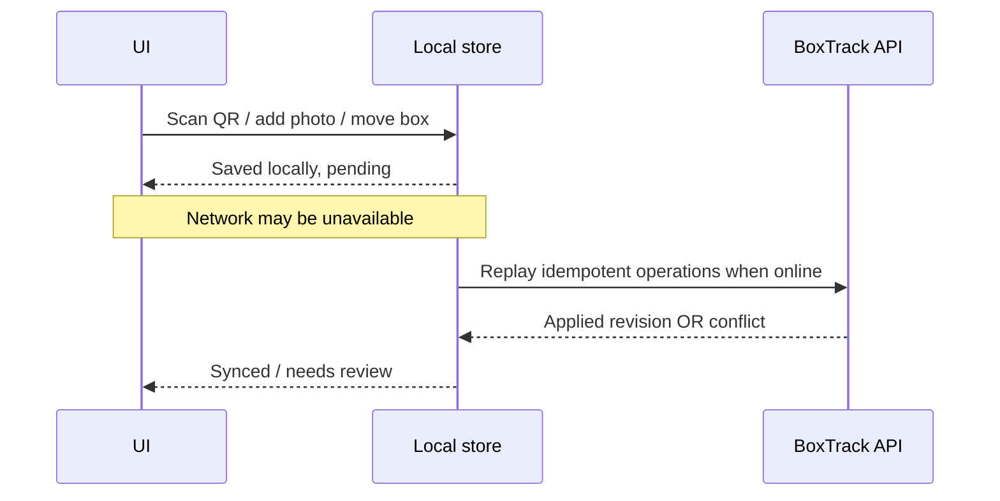

# BoxTrack — Offline and Native Clients

## Targets

Standalone responsive desktop web and native iPhone/Android/tablet clients. Existing Home Assistant app remains functional during migration, but the target user experience does not depend on HA connectivity. Important tasks—searching locally cached inventory, scanning QR, packing, recording locations and taking photos—should work offline.

## Local data model

- Cache only records the authenticated account is authorized to see for active household, with minimized sensitive gift data.
- Store catalogue metadata, item/stock summaries, authorized locations and relationships, and optional thumbnails.
- Queue mutations: add/update item, attach photo, scan/open log, confirm location, transfer, adjust stock, production activity. Include a client-generated operation ID, idempotency key, timestamp and expected server record version.
- Distinguish "saved on this device" from "synced". Do not claim a pending move is already confirmed on the server.

## Sync

- Item additions and images use safe temporary IDs remapped at sync.
- Duplicate QR scans do not create duplicate moves; repeated UPC scans may intentionally increment quantity and must be distinguishable.
- Conflicting same-box location moves need explicit review, not silent last-write-wins. Show both locations and observation times.
- Numeric stock changes use event/operation-based deltas, but validate constraints and avoid double deduction. Conditional updates are needed for overwrite-like actions.
- Changes in household membership/role/share can invalidate offline access. On session change/revocation, clear or re-key unauthorized local caches; sensitive Presents require stronger policy and explicit product caveats.
- Device clock times are observational, not an authoritative replacement for server arrival/audit times. All API timestamps UTC, display local time.
- Preserve offline capture until server acknowledgment and offer retry/recovery; images should not vanish after a failed upload.

## Native integration options

Retain Vue 3 + TypeScript responsive web and explore Capacitor for native packaging. Actual camera/barcode/QR scanner, background sync, secure local storage, OS share/print, and B1 Bluetooth printing depend on target hardware/platform support. Test on iOS, Android, tablet and desktop; do not assume a browser capability is identical to a native one.

## Test scenarios

Airplane mode while scanning a new box into a shelf; photo captured and kept after app restart; duplicate replay; multiple-device conflict; private gift cached then membership revoked; partial attachment upload; app update with queued operations; expired session; account switch.
