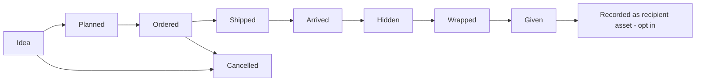

# BoxTrack — Presents Workspace

**Status:** Proposed domain and security design, pending explicit policy approval. Presents are an intentional exception to household-wide inventory visibility.

## Why this exists

Track gift ideas, ordering, shipping, arrivals, hiding places, wrapping, gifting, and "who it's from" without spoiling birthdays, Christmas, anniversaries, or surprises.

## Gift lifecycle

Entries may exist **before physical inventory exists**. Track recipient, occasion, planned/purchased/received dates, merchant, order status and optional shipment reference, gift value/cost, images, notes, gift-giver attribution, wrap state, hidden location, and reminders. Do not require a box or shelf while the gift is still an idea or in transit.

## Who owns and sees it?

- Ordinary BoxTrack inventory is household-owned. **Gift planning data is creator-controlled**, with an optional explicit grant to specific people or a restricted named group of collaborators.
- The *recipient must not see their own surprise*, even if they have normal household inventory read access or if the present's physical object is within a household room or box.
- Visibility by age/guardian relationship is a product decision; household administrator/parent status **must not silently override** private gift secrecy without a carefully documented rule.
- Private records require authorization at every retrieval, mutation, export and sync boundary. Deny by default, no data returned to disallowed callers.
- Optional sharing should specify viewer/editor rights, expiry/revocation, and whether location, cost, order, attribution or only packing status is visible. A collaborator must accept/know about sharing; not all household members are collaborators.
- For gift giver attribution, permit named labels such as "Parents", "Grandma", "Family pets" or "Santa" as presentation metadata. **Santa-related content must not be discoverable through accounts or notifications available to children.** No special code-path should treat fictional attribution as the item's true owner or payment source.
- Gift purchases on behalf of another person (e.g. Grandma) require separation of buyer, attribution, actual custodian and optional reimbursement; do not conflate them.

## Cross-view and side-channel controls

A private present hidden in Garage / Shelf 3 must not leak into:
- household universal search, suggestions, barcode lookup, recent items, category/quantity totals;
- box and shelf listings or "expected contents" seen by unauthorized members;
- location audits, last scan/open activity, photo thumbnails, automated English label descriptions or printed QR labels;
- sale/valuation lists, exports, backups accessible to nonprivileged users, webhook notifications;
- MealPlanner and other connected apps; production events sent to broad household streams;
- offline database snapshots and shared-device accounts, recently viewed lists and push previews.

**Important physical limitation:** a printed label attached to the hidden present or a visible shipping box can reveal it to anyone who sees it. Offer innocuous or no-print labeling; software permissions cannot make physical text private.

## Example flows

1. Parent saves "toy robot" as a gift idea for a child; no stock/location yet.
2. On ordering, attach optional order confirmation; track shipping/arrival without showing it to the child.
3. On arrival, scan the storage shelf and privately set `Garage / Shelving Unit 2 / Shelf 3` as hiding place. Do **not** expose the gift when the child scans the same shelf QR.
4. Parent marks wrapped and giver attribution "Santa"; child-visible exports, search, notifications and activity remain silent.
5. On delivery, mark given. Explicitly decide whether the recipient receives a standard asset record and whether to preserve or hide gift-history details.

## Permission model proposal

An additional `gift_visibility` policy protects creator-controlled gift entries; GroundCore supplies identity and household relationships but BoxTrack enforces gift domain rules. Example rights: `gift.create`, `gift.read_own`, `gift.share`, `gift.read_shared`, `gift.edit_shared`. These **are candidates, not final scope names**; do not code them until agreed in the API spec.

Offline gift data should be encrypted at rest with device-scoped protected keys, inaccessible from unrelated household sessions. On logout, grant revocation or account switch, invalidate cached gift data and queued access. Treat offline authorization lag carefully: revocation cannot be guaranteed until the device reconnects, so minimize cache lifetime and require sign-in/device unlock for private gifts.

## High-priority security tests

- Unauthorized child searches general item/room/box/shelf by gift name, barcode or QR: no hint, count change or private result.
- Unauthorized household admin/other adult cannot get creator's unshared gift through generic inventory API, historical events, activity stream, pagination, export or label.
- Private gift placed in shared box: public summary and shelf audit exclude it, with no discrepancy message suggesting secret contents.
- Revoked collaborator loses online access; offline consequences and policy limits are explicitly communicated.
- Shared phone switches from parent to child: no previous gift data in app cache, search, push banners or OS previews.
- Recipient changes across gifting lifecycle; old access never persists unintentionally.
