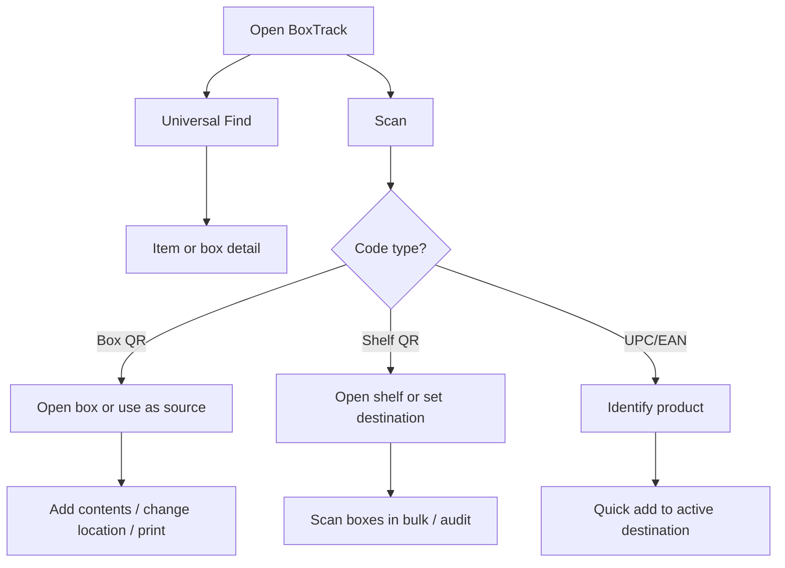

# BoxTrack — UI / UX Design

## Guiding principles

**Find it. Pack it. Label it.** A task-first modern application, not a dashboard. Universal search is always available, workspace selection is optional, and fast actions remain in context. Show compact, readable cards and real item images where available; do not force statistics screens or a mode picker on every launch.

## Navigation

Desktop: unobtrusive sidebar with Find, Locations, Scan/Pack, Labels, Items, optional workspace links and Settings. Mobile: few primary tabs and a persistent Scan action. Tablet: larger panes for browsing locations alongside item/box detail. Deep links open the addressed item or location directly with authorization.

Workspace configuration allows users to enable/disable Storage, Pantry, Belongings, Crafts, Make & Sell, Garden, Camping/RV, Digital and Presents. Workspaces are views and task defaults, not data silos or access controls. Show only authorized data in the global search.

## Adaptive item detail

Read typed capability metadata and permitted server actions, then show relevant fields:
- Food: stock lots, expiry, quantity/units, Use, Give away, Spoiled, Spilled, Transfer, Cook/Produce.
- Durable asset: purchase, warranty, serial, photos, Move, Lend, Return, List for sale.
- Craft supply: attributes such as filament type/colour or yarn lot, stock level, project use, scrap and reorder.
- Plant: variety, location, growing stage, harvest and care history.
- Digital: licence entitlements, seats, renewal and subscription details.
- Gift: private idea/order/shipping/hiding/wrapping/recipient/attribution workflow, never mixed into ordinary search for unauthorized users.

Server remains the final authority on actions; client manifests are not security controls.

## Core interaction flows

### Packing

Select box once, keep camera active for rapid photo/UPC scanning or item-name entry; offer an Undo; defer category/warranty/expiry metadata until later.

### Precise placement

Show breadcrumb e.g. Storage Locker A / Shelving Unit 2 / Shelf 3 / Box 42. Allow text-only description when granular structure is not worth creating. Scan Box then Shelf **or** Shelf then Box. Shelf-first mode supports scanning multiple boxes in sequence. A scan alone does not imply confirmed physical placement unless explicit placement/audit action is completed.

### Labels

Finish pack -> auto-generate editable human summary -> show real-size preview -> print to remembered printer/roll preset. Support reprint and stale-summary indication.

### Presents privacy

Presents entry point may use a quiet/private appearance; avoid gift-related banners, history, recents, autocomplete or notifications visible to the intended recipient. Require appropriate authorization even on shared tablets.

## Visual direction

Refined consumer-app visual design: warm neutral surfaces, restrained evergreen accent, clean typography, full-width mobile interactions and high contrast for scanning. Mockups are illustrative, not implementation or binding API specs.
